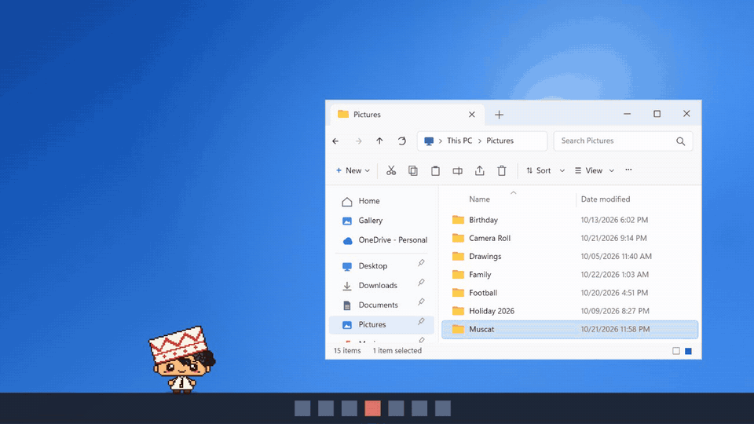
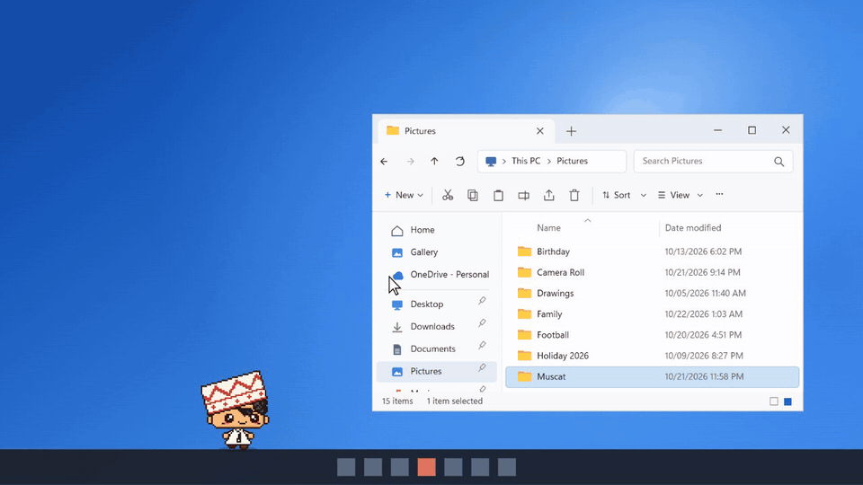
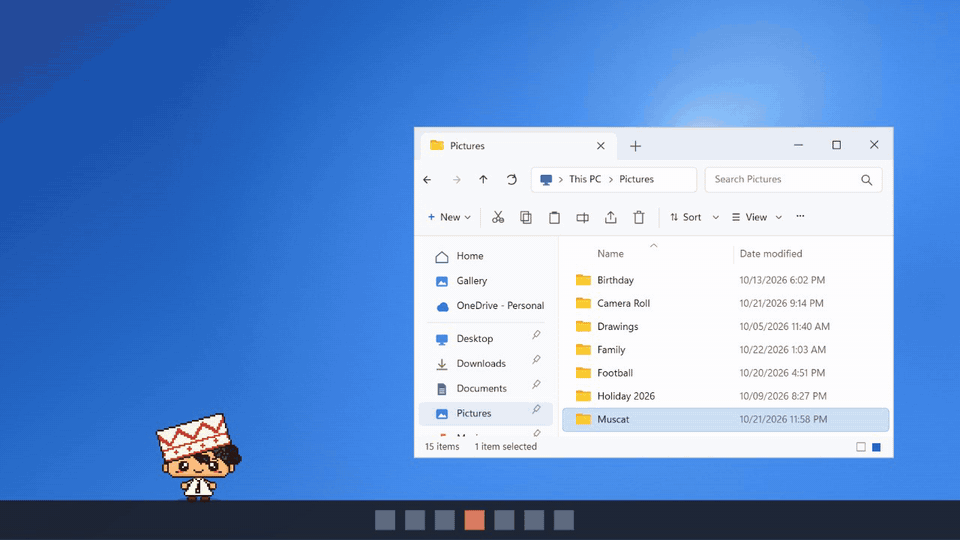
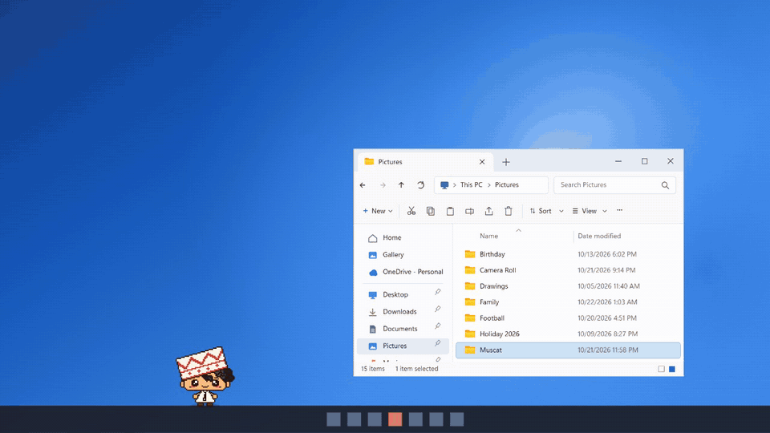

# Khalfan

  

Khalfan is a little Omani pixel boy who lives on your Windows desktop. He walks along your taskbar, climbs onto
your windows, follows your mouse, and gets angry if you keep bothering him.

  <a href="https://github.com/Ahmed-Al-Araimi/khalfan/releases/latest/download/Khalfan-Setup.exe"><b>Download Khalfan for Windows</b></a> 
  Version 1.2.0 · Windows 10 or 11 · about 100 MB

## Install

1. Download **Khalfan-Setup.exe** with the link above.
2. Double-click it. He installs in a few seconds and drops onto your taskbar. No admin rights, no questions.
3. If Windows says **"Windows protected your PC"**, click **More info**, then **Run anyway**. Khalfan is new, so
   Windows doesn't know him yet.

That's it. **He updates himself:** when a new version comes out, he downloads it quietly and is back a few
seconds later with the new tricks. What changed each time is in [CHANGELOG.md](CHANGELOG.md).

## What he does

**Pick him up and throw him.** Grab him with your mouse, swing him around, toss him onto a window. He bounces and
complains.

**Don't make him angry.** Keep annoying him and he goes into his angry power-up, then strikes one open window with
lightning and burns it away. Don't worry: the window is only **minimized to the taskbar, never closed**, so
nothing in it is lost. You can switch this off in his menu ("Rage burns a window").

**The Flying Nimbus.** He calls his little cloud and flies around your screen on it.

He also naps, sits on window edges, hangs off them and climbs back up, and talks in little pixel speech bubbles.

## What he never does

- He never clicks, types, or moves your mouse.
- He never opens, changes, moves or deletes your files.
- He sends nothing about you anywhere. He only checks this page for new versions and loads his font (Alexandria)
  from Google Fonts.

## Controls

- **His icon by the clock** (bottom-right of the taskbar): right-click it for his menu. Show or hide him, call
  him over, the Flying Nimbus, the angry power-up, his size, sound, mischief, the window burn and
  **Start with Windows**.
- **Ctrl+Alt+K** shows or hides him.

## Uninstall

Windows **Settings**, then **Apps**, then **Installed apps**, then **Khalfan**, then **Uninstall**.

## Install with your AI

Using an AI coding agent? Paste this:
`Install Khalfan for me from https://github.com/Ahmed-Al-Araimi/khalfan (follow its INSTALL.md)`

## Building your own

Want your own desktop buddy? Go for it. The code is here to learn from, so build one with your own character
and give a little credit: `Based on Khalfan by Ahmed Al Araimi`. Khalfan himself (his name, look and art)
stays mine, so please don't reuse or change him, or use him in your own videos or content, without asking
first.

---

© 2026 Ahmed Al Araimi. Khalfan, his name and his art: all rights reserved. Terms in [LICENSE.md](LICENSE.md).
